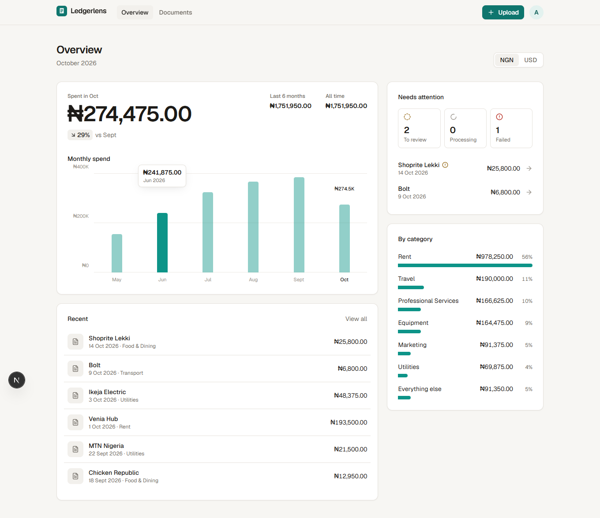
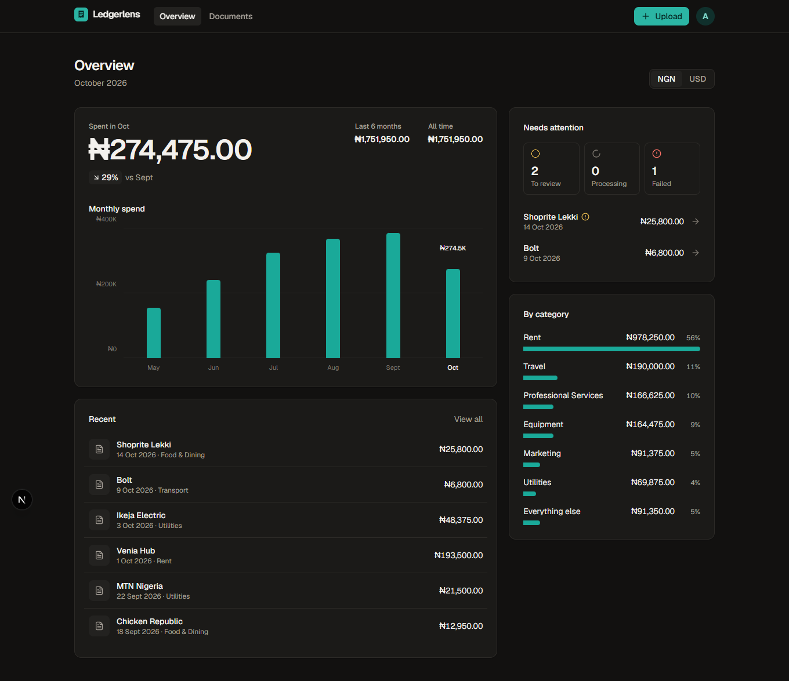
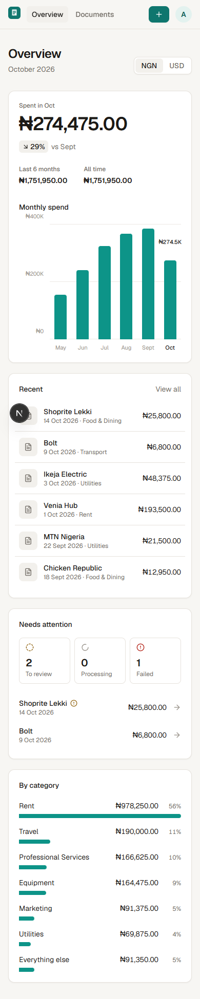

# Ledgerlens

Upload invoices and receipts; Claude reads them and turns them into structured expense data you can review, correct, chart and export.



<p>
  
  
</p>

## Features

- **Accounts**: email and password sign-up with Better Auth. Sessions are stored in Postgres, and every query, action and file download is scoped to the signed-in user. Another user's document returns a 404.
- **AI extraction**: PDFs and photos (JPEG, PNG, WebP) go to Claude with a Zod schema as a structured output. It returns the vendor, document number, dates, currency, subtotal, tax, total, category, line items and warnings about anything unreadable or inconsistent.
- **Background processing**: uploads return straight away, extraction runs after the response (`after()`), and the UI polls until it finishes.
- **Human in the loop**: every extracted field can be corrected next to the original document, and corrected documents are marked *Reviewed*.
- **Overview**: this month's spend against last month, a six-month chart with hover and keyboard tooltips (plus a table for screen readers), a category breakdown, and a "needs attention" queue. Currencies are never added together.
- **Review workflow**: documents move from *To review* to *Reviewed*. Line items are checked against the subtotal, extraction warnings are flagged, and deletes ask for confirmation.
- **Search and filters**: search across vendor, number and category, and filter by status. The list switches to a stacked layout on phones.
- **Design**: light and dark themes, chart colours checked for contrast and colour-blind safety, skeleton loading states, visible focus, and reduced-motion support.
- **CSV export**: neutralises spreadsheet formula injection.
- **Object storage**: files go to Cloudflare R2, or any S3-compatible store, under keys that contain no user input. The bucket stays private: downloads go through an ownership check and are served with `nosniff` and a sandboxing CSP.

## Stack

| | |
|---|---|
| Framework | Next.js 16 (App Router, Server Actions, Cache Components), React 19, TypeScript |
| Data | PostgreSQL 17, Prisma 7 (driver adapter `@prisma/adapter-pg`) |
| Auth | Better Auth (email and password, Prisma adapter), Next.js Proxy for redirects |
| Storage | Cloudflare R2 via `@aws-sdk/client-s3`; S3Mock in Docker for local dev |
| AI | Claude via `@anthropic-ai/sdk`, structured outputs with Zod |
| UI | Tailwind CSS 4, light and dark themes |
| Tests | Vitest |

## Running locally

Requires Node 22+ and Docker.

```bash
cp .env.example .env          # set ANTHROPIC_API_KEY and BETTER_AUTH_SECRET
docker compose up -d          # Postgres on :5433, S3-compatible storage on :9090
npm install                   # also generates the Prisma client
npx prisma migrate dev        # create the tables
npm run dev
```

Open http://localhost:3000, create an account and upload a receipt.

Without `ANTHROPIC_API_KEY`, the app runs in demo mode: uploads get labelled sample data instead of a real extraction, so the whole flow works with no key. Set `EXTRACTION_MODE` to `claude` or `demo` to force either.

To explore with realistic data, without an API key:

```bash
npm run seed:demo             # demo@ledgerlens.app / demo-password
```

```bash
npm test                      # unit tests
npm run lint
npm run build
```

## Project layout

```
src/
  app/
    (auth)/                   sign-in, sign-up and their Server Actions
    actions.ts                Server Actions: upload, correct, retry, delete
    api/auth/[...all]/        Better Auth endpoints
    page.tsx                  dashboard
    documents/                list and detail pages
    upload/                   drag-and-drop upload
    api/export/               CSV export
    api/documents/[id]/file/  serves the original upload
  lib/
    auth.ts                   Better Auth config
    session.ts                getSession / requireUser
    storage.ts                S3/R2 put, get, delete
    extraction.ts             Claude call and extraction schema
    documents.ts              queries and the extraction pipeline
    reports.ts                totals and CSV (pure, unit tested)
prisma/schema.prisma
src/proxy.ts                  redirects signed-out visitors (optimistic, cookie-only)
```

## Using Cloudflare R2

Create a bucket and an R2 API token with object read and write access, then set:

```
S3_ENDPOINT="https://<account-id>.r2.cloudflarestorage.com"
S3_REGION="auto"
S3_BUCKET="<bucket>"
S3_ACCESS_KEY_ID="<token access key id>"
S3_SECRET_ACCESS_KEY="<token secret>"
S3_FORCE_PATH_STYLE="false"
```
